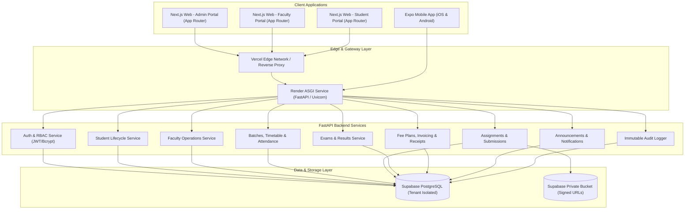

# System Architecture & Technical Specifications
## Production-Ready Tuition Management System (TMS)

### 1. Executive Summary
The Tuition Management System (TMS) is a unified, multi-tenant capable, production-ready educational operations platform. It provides role-specific portals for Institute Administrators, Faculty Members, and Students, coupled with a cross-platform React Native / Expo Mobile Application and a resilient FastAPI backend connected to Supabase PostgreSQL.

---

### 2. High-Level Architecture Diagram



---

### 3. Core Architectural Principles

1. **Single Source of Truth**: The FastAPI backend encapsulates all business validation, tenant checks, state transitions, and RBAC rules. Frontends never talk directly to raw PostgreSQL.
2. **Tenant Isolation**: Every database entity belongs to an `institute_id`. Authorization middleware guarantees that queries are partitioned per institute, preventing horizontal privilege escalation.
3. **Role-Based Access Control (RBAC)**:
   - `SUPER_ADMIN`: System-wide institute maintenance.
   - `ADMIN`: Full authority within their institute (users, courses, batches, fees, exams).
   - `FACULTY`: Authority strictly scoped to assigned batches, timetable sessions, and homework grading.
   - `STUDENT`: Read-only access to their own academic & fee records; write access only to homework submissions and profile updates.
4. **Idempotency & Financial Consistency**: Fee installments, invoice allocations, and payment receipts use transactional boundaries (`SELECT ... FOR UPDATE` or atomic DB transactions) to eliminate double-recording.
5. **Private Object Storage**: Files uploaded for homework, submissions, and student documents are stored in private object storage, delivered via short-lived expiring signed URLs.

---

### 4. Monorepo Organization

```text
tuition-management-system/
├── apps/
│   ├── web/                    # Next.js 15+ App Router, Tailwind CSS, shadcn/ui, TanStack Query
│   └── mobile/                 # React Native, Expo Router, SecureStore, TanStack Query
├── backend/                    # Python 3.10+, FastAPI, SQLAlchemy 2.0 (Async/Sync), Pydantic v2
│   ├── app/
│   │   ├── api/v1/             # Modular REST endpoints
│   │   ├── core/               # Configuration, security, database session, audit logging
│   │   ├── models/             # SQLAlchemy 2.0 declarative models
│   │   ├── schemas/            # Pydantic v2 validation and response contracts
│   │   ├── repositories/       # Encapsulated database query abstractions
│   │   ├── services/           # Domain business logic
│   │   ├── permissions/        # RBAC and tenancy route dependencies
│   │   └── main.py             # ASGI application factory
│   ├── alembic/                # Database migration scripts
│   ├── tests/                  # Pytest test suite with isolated SQLite/Postgres harness
│   ├── requirements.txt        # Backend dependencies
│   └── Dockerfile              # Production-grade multi-stage container
├── packages/
│   └── shared-types/           # Shared TypeScript interfaces & API schema contracts
├── docs/                       # Architectural, deployment, schema and user specifications
├── .env.example                # Unified environment variable template
├── package.json                # Monorepo root configuration
└── README.md                   # Setup and operations guide
```

---

### 5. Cross-Cutting Concerns

- **Authentication Flow**: Access token (JWT, short-lived 60m) + Refresh token (7 days). Secure cookie for web requests or Authorization Bearer header for mobile clients.
- **Error Handling**: Standardized RFC-7807 compliant error format (`{"error": {"code": "RESOURCE_NOT_FOUND", "message": "...", "details": []}}`).
- **Audit Logging**: All administrative mutations (student creation, fee updates, attendance overrides, exam publishing) are asynchronously committed to an immutable `audit_logs` table with actor, IP, timestamp, and diff payload.
