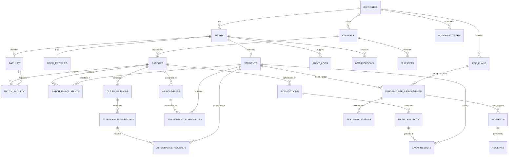

# Database Schema & Entity Relationships
## Supabase PostgreSQL Schema Specification

### 1. Entity-Relationship Overview

---

### 2. Table Specifications

#### 2.1 Identity & Tenants
- **`institutes`**: Multi-tenant anchor (`id UUID PRIMARY KEY`, `name TEXT`, `code VARCHAR(20) UNIQUE`, `currency VARCHAR(3) DEFAULT 'INR'`, `timezone VARCHAR(50) DEFAULT 'Asia/Kolkata'`, `created_at TIMESTAMP`).
- **`users`**: Authentication credentials (`id UUID PRIMARY KEY`, `institute_id UUID REFERENCES institutes`, `email VARCHAR(255) UNIQUE`, `hashed_password TEXT`, `role VARCHAR(20)`, `is_active BOOLEAN`, `is_verified BOOLEAN`, `invitation_token TEXT`, `created_at TIMESTAMP`).
- **`user_profiles`**: Personal profile data (`id UUID PRIMARY KEY`, `user_id UUID REFERENCES users ON DELETE CASCADE`, `first_name VARCHAR(100)`, `last_name VARCHAR(100)`, `phone VARCHAR(20)`, `avatar_url TEXT`, `address TEXT`).

#### 2.2 Academic Core
- **`courses`**: Academic programs (`id UUID PRIMARY KEY`, `institute_id UUID`, `name TEXT`, `code VARCHAR(30)`, `description TEXT`).
- **`subjects`**: Course curriculum items (`id UUID PRIMARY KEY`, `course_id UUID REFERENCES courses`, `name TEXT`, `code VARCHAR(30)`).
- **`batches`**: Student cohort group (`id UUID PRIMARY KEY`, `course_id UUID`, `name TEXT`, `capacity INT`, `start_date DATE`, `end_date DATE`, `status VARCHAR(20)`).
- **`batch_faculty`**: Faculty assignment to batch and subject (`id UUID PRIMARY KEY`, `batch_id UUID REFERENCES batches`, `faculty_id UUID REFERENCES faculty`, `subject_id UUID REFERENCES subjects`).
- **`batch_enrollments`**: Student cohort membership (`id UUID PRIMARY KEY`, `batch_id UUID REFERENCES batches`, `student_id UUID REFERENCES students`, `roll_number VARCHAR(50)`, `status VARCHAR(20)`).

#### 2.3 Attendance System
- **`attendance_sessions`**: Single class roll-call instance (`id UUID PRIMARY KEY`, `batch_id UUID`, `faculty_id UUID`, `session_date DATE`, `topic TEXT`, `status VARCHAR(20)`).
- **`attendance_records`**: Per-student verification (`id UUID PRIMARY KEY`, `attendance_session_id UUID REFERENCES attendance_sessions`, `student_id UUID REFERENCES students`, `status VARCHAR(20) CHECK (status IN ('PRESENT', 'ABSENT', 'LATE', 'EXCUSED'))`, `remarks TEXT`).
- **`attendance_change_logs`**: Audit trail for corrections (`id UUID PRIMARY KEY`, `attendance_record_id UUID`, `previous_status VARCHAR(20)`, `new_status VARCHAR(20)`, `reason TEXT`, `changed_by UUID`).

#### 2.4 Homework & Assessments
- **`assignments`**: Teacher assignments (`id UUID PRIMARY KEY`, `batch_id UUID`, `subject_id UUID`, `faculty_id UUID`, `title TEXT`, `description TEXT`, `due_date TIMESTAMP`, `max_marks NUMERIC(5,2)`, `attachment_url TEXT`).
- **`assignment_submissions`**: Student work upload (`id UUID PRIMARY KEY`, `assignment_id UUID`, `student_id UUID`, `submission_date TIMESTAMP`, `content TEXT`, `attachment_url TEXT`, `marks_obtained NUMERIC(5,2)`, `feedback TEXT`, `status VARCHAR(20)`).
- **`study_materials`**: Lecture notes & references (`id UUID PRIMARY KEY`, `batch_id UUID`, `subject_id UUID`, `title TEXT`, `file_url TEXT`, `file_type VARCHAR(50)`).

#### 2.5 Examinations & Results
- **`examinations`**: Institute or batch test schedules (`id UUID PRIMARY KEY`, `batch_id UUID`, `title TEXT`, `exam_type VARCHAR(50)`, `start_date DATE`, `end_date DATE`, `status VARCHAR(20)`).
- **`exam_subjects`**: Subject papers (`id UUID PRIMARY KEY`, `examination_id UUID`, `subject_id UUID`, `exam_date DATE`, `max_marks NUMERIC(5,2)`, `passing_marks NUMERIC(5,2)`).
- **`exam_results`**: Graded scores (`id UUID PRIMARY KEY`, `exam_subject_id UUID`, `student_id UUID`, `marks_obtained NUMERIC(5,2)`, `grade VARCHAR(5)`, `is_published BOOLEAN DEFAULT FALSE`).

#### 2.6 Fees & Financial Invoicing
- **`fee_plans`**: Master pricing template (`id UUID PRIMARY KEY`, `course_id UUID`, `name TEXT`, `total_amount NUMERIC(12,2)`, `currency VARCHAR(3)`).
- **`student_fee_assignments`**: Student billing ledger (`id UUID PRIMARY KEY`, `student_id UUID`, `fee_plan_id UUID`, `total_amount NUMERIC(12,2)`, `discount_amount NUMERIC(12,2) DEFAULT 0`, `net_amount NUMERIC(12,2)`, `status VARCHAR(20)`).
- **`fee_installments`**: Milestone payment schedule (`id UUID PRIMARY KEY`, `student_fee_assignment_id UUID`, `installment_number INT`, `due_date DATE`, `amount NUMERIC(12,2)`, `paid_amount NUMERIC(12,2) DEFAULT 0`, `status VARCHAR(20)`).
- **`payments`**: Transaction records (`id UUID PRIMARY KEY`, `student_id UUID`, `fee_assignment_id UUID`, `amount NUMERIC(12,2)`, `payment_method VARCHAR(30)`, `transaction_reference VARCHAR(100)`, `status VARCHAR(20)`).
- **`receipts`**: Official tax/fee receipts (`id UUID PRIMARY KEY`, `payment_id UUID UNIQUE`, `receipt_number VARCHAR(50) UNIQUE`, `receipt_date DATE`, `pdf_url TEXT`).

#### 2.7 Communications & Audit
- **`announcements`**: Bulletin notifications (`id UUID PRIMARY KEY`, `institute_id UUID`, `title TEXT`, `content TEXT`, `target_audience VARCHAR(20)`, `priority VARCHAR(20)`).
- **`notifications`**: Personalized alert stream (`id UUID PRIMARY KEY`, `user_id UUID`, `title TEXT`, `message TEXT`, `link TEXT`, `is_read BOOLEAN DEFAULT FALSE`).
- **`audit_logs`**: Security compliance record (`id UUID PRIMARY KEY`, `institute_id UUID`, `user_id UUID`, `action VARCHAR(100)`, `entity_type VARCHAR(50)`, `entity_id VARCHAR(50)`, `details JSONB`).
